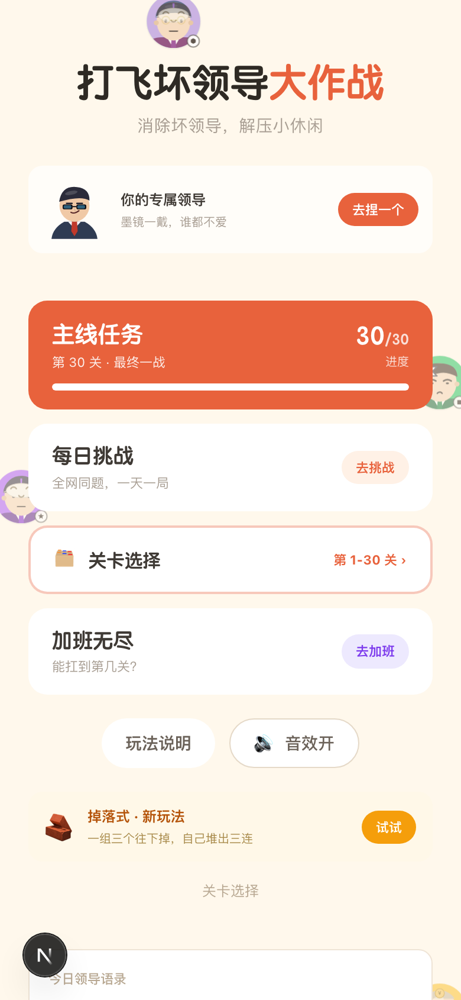
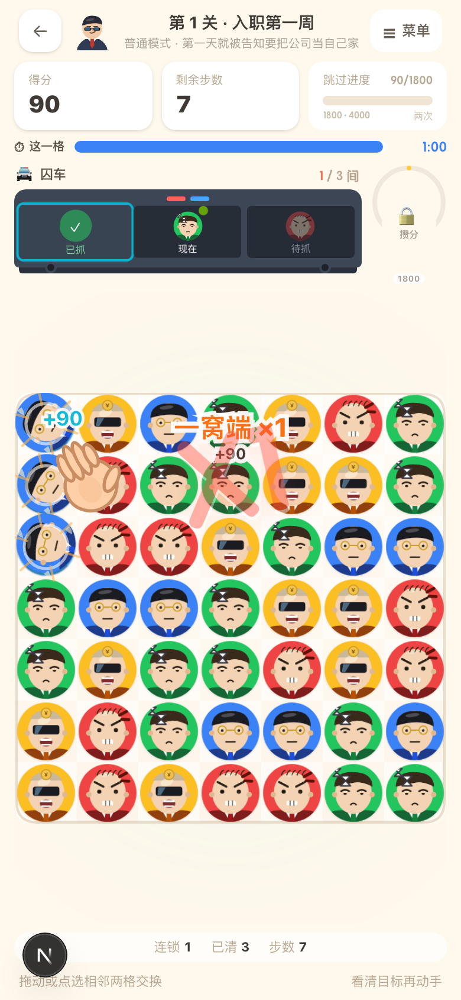
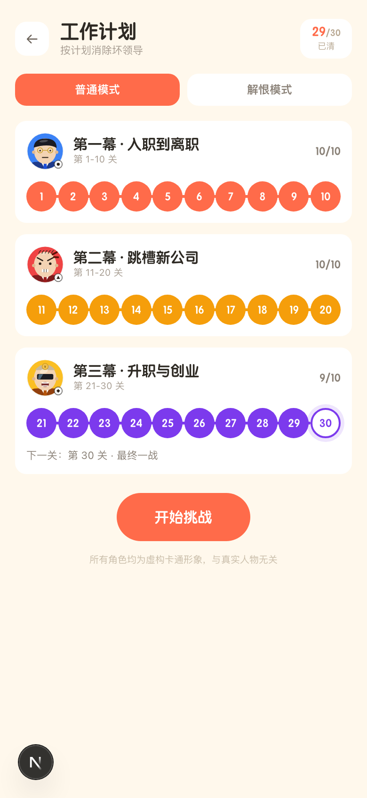

# 💥 打飞坏领导

> 交换相邻的坏领导，三个连一起就能清场。
> 一款把「被职场 PUA 却没处发作」做成玩法出口的三消小游戏。

<p align="center">
  
  
  
</p>

**本地跑起来：** `npm run setup && npm run dev` → http://localhost:3100，不需要任何 API Key，开箱即跑。

| | |
|---|---|
| 玩法 | 主线 30 关 + 每日挑战 + 加班无尽 |
| 体量 | 静态导出 1.2 MB，零图片素材（角色全部 canvas 代码绘制） |
| 质量 | 46 个内核单测 + 28 条 Playwright 端到端，全绿 |
| 后续 | 内核与渲染分离，同一套内核直接复用到小程序 |

---

## 快速开始

```bash
npm run setup   # 装依赖 + 编译内核
npm run dev     # 启动网站
```

打开 **http://localhost:3100** 即可。

| 页面 | 地址 |
|---|---|
| 首页 | `/` |
| 关卡选择 | `/levels/` |
| 捏个领导 | `/avatar/` |
| 游戏 | `/play/?level=1` |

---

## 玩法

拖动或点选相邻两格交换，三个同类型连成一线就消除。

**主题：5 种职场坏领导**

| 领导 | 口头禅 | 机制 |
|---|---|---|
| 画饼王 | 「年轻人要看长远」 | 基础型 |
| 甩锅侠 | 「这个我交代过你吧」 | 消除后甩锅污染相邻格 |
| 抢功精 | 「这个项目我带着做的」 | 要清两次才倒 |
| 加班魔 | 「反正你也没什么吧」 | 被打掉时反咬一口 |
| 形式怪 | 「先做个周报同步一下」 | 十字爆裂，掀掉表格 |

机制和口头禅是对应的——甩锅侠真的会甩锅，抢功精真的要抢两次。

**你要救的是打工人**：入职两年饼吃了三张的小林、连上 12 天班的小美、
方案被领导拿去汇报的陈工。

### 话术系统（灵魂所在）

**失败时**，领导会 PUA 你：

```
画饼王 说：
「年轻人不要总盯着工资，要看重成长。」
潜台词：成长是你的，钱是我的。
```

**通关时**，触发话术对决——领导挑衅，你从 3 个应对里选：

```
「这个方向我早就想过了，只是还没来得及说。」

A. 那您真是高瞻远瞩             （讨好 +0）
B. 想过了但没说，等于没想         （反杀 +80，标「最佳」）
C. 嗯，我记下了                 （中性 +20）
```

### 捏个领导

10 个维度自由组合：性别气质 / 脸型 / 发型 / 发色 / 眉毛 / 表情 / 行头 / 衣服颜色 / 随身道具 / 肤色。
内置 4 个预设。捏好的形象会出现在首页、游戏顶栏和结算页，并触发一句人设吐槽。

> ⚠️ **合规说明**：所有角色均为虚构卡通形象，与任何真实人物、组织无关。
> 捏人系统只提供固定选项组合，**不支持上传照片，也不能填写真实姓名** —— 这不是偷懒，
> 是刻意设计：一旦能上传照片，就变成了「给讨厌的真人做肖像」，法律和小程序审核都过不去。

---

## 技术架构

```
packages/game-core/   纯 TS 游戏内核（零 DOM 依赖，35 个单测）
apps/web/             Next.js 15 网页版（静态导出，可丢任意静态托管）
scripts/              Playwright 端到端验证
```

三个核心决策：

**① 内核与渲染彻底分离**
`game-core` 只管规则（能不能消、得几分、胜负），`engine.ts` 只管手感（动画、粒子、震屏、音效）。
同一套内核将来直接搬进小程序。

**② 自研渲染，不用游戏引擎**
消除游戏的复杂度在逻辑和手感，不在渲染。零引擎 + 零图片素材（全部 canvas 代码绘制），
包体极小，也才能支持「无限组合」的捏人系统。

**③ 确定性随机**
所有随机走带种子的 RNG：每日挑战可全服同一副棋盘，出 bug 能凭种子 100% 复现。

**④ 与 AI 结对开发**
整个项目由一个 AI coding agent（DeepSeek Harness，deepseek-flash）与作者结对完成：
作者定规则、目标值和验收标准，AI 负责写实现、补测试、跑平衡实验、按截图迭代 UI。
为了让"AI 改代码"可控，工程上做了几件事——`docs/RULES-3.0.md` 里一条规则只留一种表述
（早期"算完成/不算完成"并存时 AI 会反复改错方向）、随机走种子（bug 可 100% 复现）、
Playwright 截图自检（改完能自证没坏）。

---

## 开发命令

```bash
npm run dev        # 启动网站（:3100）
npm run build      # 生产构建（静态导出到 apps/web/out）
npm run test       # 内核单测（46 个）
npm run typecheck  # 全仓库类型检查

# 端到端验证（真实浏览器操作 + 截图）
PLAYWRIGHT_BROWSERS_PATH=./.pw-browsers node scripts/verify-interaction.mjs
```

---

## 文档

- [设计与机制文档](docs/DESIGN.md) —— 合规边界、角色机制、关卡平衡实测数据、小程序化路线
- [规则 v3.0](docs/RULES-3.0.md) —— 当前生效的完整规则，一条规则只留一种表述
- [风险与修复](docs/RISK-FIXES.md) —— 11 条规则风险的处理方案与取舍

调关卡平衡时踩过的坑都记在里面了，包括：
- 保护伞「清整列」会自激爆炸（平均清 176 格，棋盘才 64 格）
- 恶霸「每个扣 1 步」让玩家莫名掉十几步
- 连锁 4 倍加成让星级失去意义

---

## 已验证

| 项 | 状态 |
|---|---|
| 内核单测 | 46/46 通过 |
| 端到端 · 核心玩法 | 14/14 通过 |
| 端到端 · 救援 / 模式 | 14/14 通过 |
| 全仓库类型检查 | 0 错误 |
| 生产构建 + 静态导出 | 通过 |
| 关卡平衡 | 总胜率 81%，三星率 43% |
| 控制台报错 | 无 |
